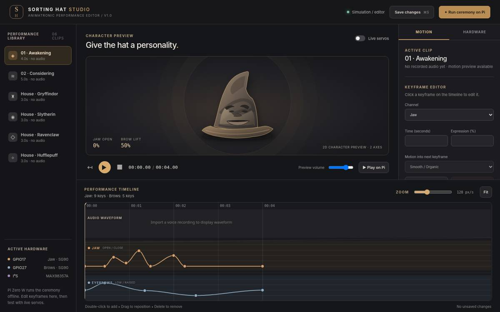

# Sorting Hat Studio

A fully local Raspberry Pi Zero W animatronic Sorting Hat: one MAX98357A I²S amplifier, two SG90 servos, and an optional pressure/button trigger. **No Arduino, DFPlayer, DAC/filter, internet, or cloud account.** The Pi stores recordings and animation tracks; another computer or phone on the same Wi-Fi can open the editor.



**Live browser preview:** https://joramvanloenen.github.io/Sorting-Hat-Studio/ (GitHub Pages, static editor). This preview saves edits locally in your browser. Export `project.json` to transfer to the Pi; the Pi-hosted editor can directly control hardware.

The root `index.html`, `app.js`, `style.css`, `audio/`, `project.json`, and `settings.json` are the static GitHub Pages editor. The `static/`, `server.py`, `hat_core.py`, and `data/` files are for the actual Pi.

## Offline audio-to-motion workflow (GitHub Pages)

Open [Sorting Hat Studio](https://joramvanloenen.github.io/Sorting-Hat-Studio/) in a modern browser. **No connection to the Raspberry Pi is needed.** The online editor processes recordings locally using Web Audio; no audio is uploaded to a server.

1. Click **Audio → Motion** or drop a WAV/MP3/OGG file onto the hat preview.
2. The browser automatically detects speech and pauses, creates editable **jaw and brow** keyframes, and overlays the waveform.
3. Press **▶ Play** to hear the recording synchronized with the animated hat. Scrub or drag keyframes to fine-tune it.
4. Adjust **Thoughtful**, **Subtle**, or **Theatrical** style, jaw intensity, silence threshold, and eyebrow expressiveness; click **Generate jaw + eyebrows** to rebuild the tracks.
5. Press **Save changes** to preserve the animation in browser storage, or **Export JSON** to take the animation to the Pi.

**Storage and compatibility:** The static editor saves the project in browser localStorage and imported audio in IndexedDB. Keep a copy of your files: private browsing, site-data cleanup, or storage limits can erase them. The JSON export contains keyframes, **not** embedded audio. Download the matching audio separately. The Pi's audio player uses PCM WAV files, so MP3/OGG imports need conversion to WAV when transferring the finished project to the Pi.

The timeline is speech-energy-informed, not a phoneme recognition system. It deliberately varies mouth opening and creates slower phrase-based eyebrow gestures to avoid mechanical flapping. All generated points remain editable.

## Features

- **Browser timeline editor:** separate jaw and eyebrow tracks, interactive keyframes, smooth/linear/hold easing, playhead seeking, and waveform overlay.
- **Expression preview:** 2D animated face preview without any Raspberry Pi hardware, with optional live servo preview when running on the Pi.
- **Offline natural audio-to-motion:** import a voice file and automatically generate editable jaw and independent phrase-based eyebrow curves in the browser.
- **Independent brow acting:** expressive gestures generated around phrase boundaries, with hand-editable keyframes for precise acting.
- **Standalone clip playback:** optional GPIO22 button plays a single configured clip (`trigger_clip` in settings). New projects begin with a blank performance. For a fresh checkout, run the demo-audio conversion script (below) to prepare them as WAV files for Pi playback.
- **Servo calibration:** programmable safe min/max pulse widths, inverted direction, and rest pose.
- **Adjustable sync offset:** milliseconds of playback latency compensation for `aplay` and the MAX98357A ALSA driver.
- **Simulation mode:** the editor and individual-clip player run on any PC with Python 3.10+.
- **Pi hardware mode:** pigpio DMA-based servo pulses, using PWM clock mode to keep the PCM/I²S interface available.

## Hardware wiring

Connect this board **directly to the Raspberry Pi Zero W**:

| MAX98357A | Raspberry Pi BCM GPIO | Physical header pin |
|---|---|---|
| BCLK | GPIO18 | 12 |
| LRC / LRCLK | GPIO19 | 35 |
| DIN | GPIO21 | 40 |
| VIN | 5V | 2 or 4 |
| GND | GND | 6 |
| SPK+ and SPK− | Passive 4Ω–8Ω speaker | — |

Additional wires:

| Component | Raspberry Pi | Power |
|---|---|---|
| Jaw SG90 **orange** | GPIO17 (header 11) | red to external regulated +5V, brown to external ground |
| Brow SG90 **orange** | GPIO27 (header 13) | red to external regulated +5V, brown to external ground |
| Hidden button | GPIO22 (header 15) and ground | No external supply; internal pull-up enabled |

**Important:** Join the servo supply GND to the Pi GND. Do **not** connect the servos' red leads to GPIO 3.3V or feed their stall current through the Pi's GPIO/header power rail. Use a separate reliable 5V supply rated at least 2A for the servos; power the Pi and amp from an adequately rated supply. No speaker terminal may be connected to ground. Disconnect the servos' mechanical linkages for first calibration. Limit speaker volume to safe levels near a person's ears.

The MAX98357A breakout's GAIN and SD pins can normally be left unconnected at first; follow your specific board's datasheet if it differs.

## Pi setup — Raspberry Pi OS Lite **32-bit Bookworm** (most straightforward)

The Pi Zero W v1.1 is a relatively small single-core board. **32-bit Raspberry Pi OS Lite Bookworm** is a practical tested-era dependency choice; on newer Trixie, the old `pigpiod` executable may be missing (see below). We have not tested this project on your actual Pi.

1. Install 32-bit Raspberry Pi OS Lite (Bookworm) on a microSD card using Raspberry Pi Imager, with Wi-Fi and SSH enabled.
2. On the Pi, install packages:

   ```bash
   sudo apt update
   sudo apt install -y python3-pigpio pigpio python3-gpiozero alsa-utils ffmpeg unzip
   ```

3. Enable the I²S amp by editing the active `/boot/firmware/config.txt` (older systems use `/boot/config.txt`):

   ```ini
   # Disable built-in PWM audio / old GPIO18 audio remapping
   #dtparam=audio=on
   # Remove or comment out any dtoverlay=audremap,pins_18_19 setting

   # MAX98357A I²S audio
   dtoverlay=max98357a
   ```

   Reboot. Verify with `aplay -l` and listen to a low-volume `speaker-test -c 2 -t wav` (press Ctrl+C to stop). If the audio card is detected but ALSA default points elsewhere, set the **ALSA device** in the editor hardware tab to `plughw:0,0` or the card ID shown by `aplay -l`. Some newer Raspberry Pi OS versions may require an `/etc/asound.conf` default-device setting.

4. **Important with I²S:** start pigpio with its **PWM** timing clock, freeing PCM for I²S. The `-t 0` flag is essential; the default pigpio clock is PCM.

   ```bash
   sudo systemctl disable --now pigpiod 2>/dev/null || true
   sudo pigpiod -t 0 -l
   ```

   Don't call `hardware_PWM` or pigpio wave APIs: the servo driver here only calls `set_servo_pulsewidth`.

5. Clone this repository onto the Pi and convert the included small MP3 demo lines to WAV with `bash scripts/prepare-demo-audio.sh`. Then run:

   ```bash
   cd ~/Sorting-Hat-Studio
   python3 server.py --hardware --host 0.0.0.0 --port 8080
   ```

6. From a computer on the same trusted Wi-Fi, visit `http://<PI_IP_ADDRESS>:8080`. To find the Pi's IP, run `hostname -I` on it. Don't forward port 8080 to the internet: the editor is not authenticated.

7. On the **Hardware** tab, verify GPIO17 and GPIO27, adjust pulse ranges conservatively and confirm servo motion *without mechanical linkages*. Only then attach the jaw and eyebrow connections.

### Raspberry Pi OS Trixie note

`python3-pigpio` may still be available while the actual `pigpiod` daemon is not. If `sudo apt install pigpio` fails, you can either use Bookworm Lite or compile [joan2937/pigpio](https://github.com/joan2937/pigpio) from source:

```bash
sudo apt install -y git build-essential python3-setuptools python3-pigpio python3-gpiozero alsa-utils ffmpeg
git clone --depth 1 https://github.com/joan2937/pigpio.git ~/pigpio-src
cd ~/pigpio-src
make -j2
sudo make install
sudo ldconfig
sudo pigpiod -t 0 -l
```

On some Trixie versions the Pi OS sound card default also needs adjustment. Before launching this app in hardware mode, confirm both `aplay -l` and `python3 -c 'import pigpio; print(pigpio.pi().connected)'` work.

### Start automatically on power-up

After you have tested manual execution and calibrated the hardware, run from the project directory:

```bash
sudo bash scripts/install-service.sh
```

This installs systemd services to start pigpiod in PWM-clock mode and Sorting Hat Studio in hardware mode. It uses the current project's absolute path and the username of the person invoking `sudo`.

Check logs with `sudo journalctl -u sorting-hat -f`.

## Quick simulation on a PC

No libraries required for a preview:

```bash
cd sorting-hat-studio
python3 server.py
```

Open `http://127.0.0.1:8080` in your browser. The face, editor, timeline and individual clip playback work. **Actual GPIO and speaker playback require the Pi hardware**, and audio import requires `ffmpeg` to be installed on the machine running the server.

## Using the editor

1. Choose any recording from the library. The six previous ceremony demonstration entries are no longer included.
2. Click **Import dialogue audio** and supply your own original voice recording (MP3/WAV/OGG/etc.). It is converted locally to standard stereo PCM WAV for reliable ALSA playback. The included eSpeak demo voice is deliberately robotic and can be replaced at any time.
3. Select **Generate jaw keyframes** to create a rough mouth performance from audio energy. Tune intensity and silence threshold. This changes *only* the jaw animation.
4. Edit by double-clicking a track to add a keyframe, dragging to change time/expression, clicking a point for numeric edits, and pressing Delete to remove. Curve easing is assigned to the segment **after** the selected key.
5. Create your own eyebrow expressions for thoughtful pauses and reactions.
6. Press ▶ beside the timeline for browser audio + motion preview. Enable **Live servos** after connecting/calibrating the Pi hardware. Browser-to-Pi servo preview over Wi-Fi can have latency.
7. Press **Play on Pi** to hear an actual synchronized performance of the selected clip. The optional GPIO22 button plays one clip identified by `trigger_clip` in settings.

Pi-hosted edits are saved automatically into `data/project.json`; hardware configuration is saved to `data/settings.json`. Imported audio is stored under `data/audio/`.

## About synchronization and animation realism

The engine drives both servos every ~20ms while a clip is playing. It measures elapsed time with a monotonic clock rather than using audio-volume samples captured from a microphone. The offset in the Hardware tab compensates for `aplay` startup and ALSA audio buffering: **increase positive offset if the jaw begins ahead of the audio**, reduce it if motion lags.

This is a practical timer + calibrated latency solution, **not sample-accurate ALSA presentation-clock synchronization**. It should be suitable for short prop performances with tuning, but the offset may vary slightly at startup. The browser preview and on-Pi performance each use their own clock.

The auto-generated mouth track uses recorded amplitude, not phoneme recognition. To feel alive: use varied jaw openings for vowels, close during silence, make brow changes **anticipate** important words, and maintain asymmetric thoughtfulness with holds and tiny lifts instead of constantly twitching.

## Troubleshooting

- **No sound:** check `dtoverlay=max98357a`, reboot, then run `aplay -l` and `speaker-test -c 2 -t wav`. Do not use `dtoverlay=audremap` when I²S is enabled.
- **No servo movement:** the editor defaults to simulation; launch with `--hardware`, start `pigpiod -t 0`, connect common grounds and an external servo 5V supply.
- **Servo jitters:** use `pigpiod -t 0` instead of the standard software PWM servo path, check the power supply and linkage friction.
- **Speech is early/late:** adjust the Audio start compensation in the Hardware tab.
- **Demo voice:** six original eSpeak demo lines are included; replace them with your recorded dialogue for natural character acting.
- **No headphone output:** correct; the MAX98357A drives a passive speaker directly.
- **Editor accessible from public internet:** do not expose it. It does not have authentication or HTTPS.

## Development / tests

```bash
PYTHONPATH=. python3 -m unittest discover -s tests -p 'test_*.py' -v
python3 tests/smoke_http.py
```

The editor uses no third-party JavaScript frameworks. Backend requires only the Python standard library in simulation mode. Hardware mode imports `pigpio` and `gpiozero` on the Pi.

## Browser-only GitHub Pages editor

The live site provides the animated face, timeline, waveform, clip library, individual-clip preview, and local editing; **GitHub Pages cannot execute Python or control GPIO**. Changes save to this browser (localStorage + IndexedDB), not your GitHub repository. Use **Export JSON** and transfer that `project.json` to the Pi `data/project.json`; convert downloaded audio to `data/audio/<clip-id>.wav` with `ffmpeg -i source.mp3 -ar 44100 -ac 2 -c:a pcm_s16le dest.wav`. The Pi's own editor at `http://<PI_IP>:8080` can upload audio and operate the servos directly.

To initialise demo audio after cloning:

```bash
bash scripts/prepare-demo-audio.sh
```

## No more bundled ceremony performances

Fresh installs show a single empty **New Performance**. The old six library entries (Awakening, Considering and the four houses) are removed from the default project data.

The online editor automatically migrates `sorting-hat-pages-project-v1` into `sorting-hat-pages-project-v2`: previously imported custom recordings are kept, while the old factory entries are hidden. The complete previous project is backed up in localStorage under `sorting-hat-legacy-project-backup-v1`, so edits made to a factory entry are not permanently discarded. Browser-stored audio files are not deleted.

A previously installed Pi stores its own `data/project.json`, so updating the repository alone does not overwrite that file. Backup and replace it with the new blank `data/project.json` if you want the same reset on the Pi.
